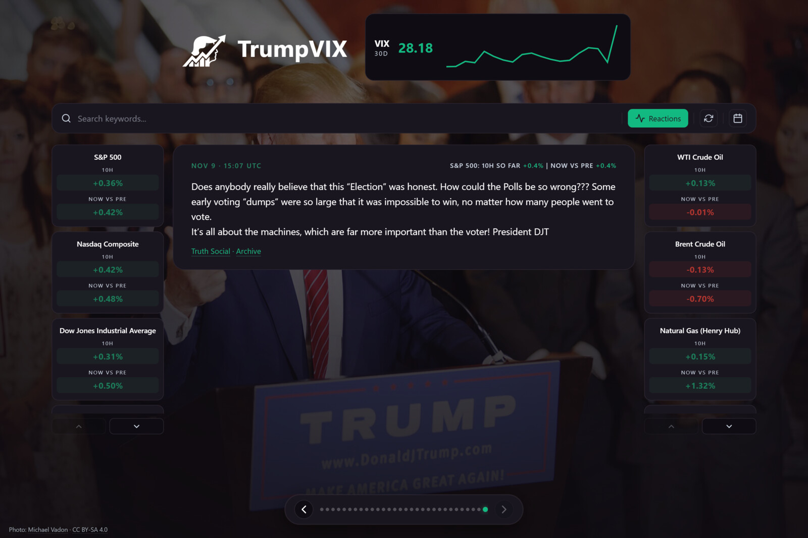

<p align="center">
  
</p>

<h1 align="center">TrumpVIX</h1>

<p align="center">Local dashboard tracking Trump Truth Social statements against market reactions.<br>No inference, no opinions — just data.</p>

<p align="center">
  <a href="CHANGELOG.md">Changelog</a> ·
  <a href="https://github.com/JonPinto/trumpvix/releases">Releases</a> ·
  <a href="#roadmap">Roadmap</a>
</p>

---

## What it is

TrumpVIX pulls posts from the [trumpstruth.org](https://trumpstruth.org) RSS feed, stores them in a local SQLite database, and shows how 12 market series moved around each post. It runs entirely on your machine — no accounts, no cloud backend, no API keys.

Packaging as a standalone desktop or mobile app is not implemented yet. This README covers running from source.

A read-only **static demo** is live at <https://trumpvix-sh.netlify.app/> — the same frontend with the latest data baked in and no backend. Its source is [`trumpvix-demo`](https://github.com/JonPinto/trumpvix-demo). See [Static demo](#static-demo).

<p align="center">
  
</p>

<p align="center"><em>Statement card, reaction panels, VIX sparkline and a Commons background.</em></p>

## What you get

- **Statement feed** — swipe, keyboard arrows or click through posts; up to 30 posts per view.
- **Reaction summary** — the S&P 500 10-hour move and "now vs. pre-post" on every card.
- **12-series panels** — indices, currencies, energy, metals and crypto in two columns.
- **Timeline** — up to 30 dots with arrow buttons; phones show the arrows only.
- **Search and date picker** — keyword search with highlighted matches, or jump to a UTC day.
- **Media** — a 1–4 tile grid, full-screen viewing with ‹ › cycling, and in-place video playback with a progress bar.
- **Backgrounds** — a random Wikimedia Commons photo, landscape on desktop and portrait on phones, credited in-app.
- **Mobile layout** — larger type and tap targets at 640px and below, two-row search and a stacked card header.
- **Live refresh** — the refresh button shows progress, and the page reloads data as each source lands.
- **VIX sparkline** — 30-day VIX in the header.

## Requirements

- Python 3.12 or newer (tested on 3.14).
- Internet access for ingestion: RSS, Yahoo Finance, FRED and Wikimedia Commons.
- About 100 MB for the code and virtualenv, plus temporary space for the video cache.
- Linux or macOS. Windows is not regularly tested.

## Quick start

```bash
git clone https://github.com/JonPinto/trumpvix.git
cd trumpvix

python3 -m venv .venv
source .venv/bin/activate          # Windows: .venv\Scripts\activate
pip install -r requirements.txt

python scripts/server.py
```

Open **http://127.0.0.1:5000**.

On first run the server creates `data/mvp.sqlite3`, starts a background refresh, and serves the page immediately. Cards fill in as each source finishes, usually within about 10 seconds. The refresh button next to the date picker re-runs the pipeline at any time.

If the page says "API unavailable", the server is not running or is on a different port.

> The dev server listens on **127.0.0.1** by default, so only this machine can reach it. There is still no login: to serve other devices on your network, start it with `HOST=0.0.0.0` and read [Security](#security) first.

## How it works

### Data sources

| Source | Used for | Notes |
|---|---|---|
| [trumpstruth.org](https://trumpstruth.org/feed) RSS | Posts and media | Full provenance (`source_url`, `original_url`) |
| Yahoo Finance via `yfinance` | Hourly intraday bars | Last 5 days per fetch; ETF/ETN proxies; unofficial and possibly delayed |
| [FRED](https://fred.stlouisfed.org/) CSV | Daily indicators | VIX, dollar index, Treasuries, copper, gasoline; up to 3 attempts with backoff |
| OpenGraph | Link previews | Title, description, image, site name |
| [Wikimedia Commons](https://commons.wikimedia.org/) | Page background | Landscape on desktop, portrait on mobile; credited in-app |

Intraday proxies are defined in [`scripts/series.py`](scripts/series.py) — for example SPY for the S&P 500, QQQ for the Nasdaq, USO for WTI and ^VIX for the VIX. Bitcoin and Ethereum use their Yahoo tickers directly.

### Reaction model

For each post, the dashboard measures the change from the last price at or before the post to the price 10 **NYSE open hours** later:

- Counting only 9:30–16:00 ET, Monday–Friday.
- If the post lands before the open, the window starts at 9:30 that day.
- If it lands after the close, the window starts at the next trading day's open.
- If it lands on a weekend, the window starts on Monday's open.
- The window carries across sessions and weekends.
- US market holidays are not handled yet.

The card summary uses the S&P 500; expanding a card shows all 12 reaction series. Each series also shows the move from the pre-post price to the latest price.

### Storage

Everything lives in one SQLite file, `data/mvp.sqlite3` by default:

| Table | Contents |
|---|---|
| `statements` | Posts, text, HTML, provenance, first media URL |
| `statement_media` | Every image/video for a post, in feed order |
| `indicators` | Indicator metadata (FRED and intraday) |
| `indicator_points` | Daily FRED observations |
| `intraday_points` | Hourly Yahoo bars |
| `link_previews` | OpenGraph metadata |
| `sources` | Feed/source metadata |

The database is created automatically and is gitignored. To start over, stop the server and delete the file.

## Configuration

| Variable | Default | Read by | Description |
|---|---|---|---|
| `MVP_DB_PATH` | `data/mvp.sqlite3` | server and scripts | SQLite database path |
| `HOST` | `127.0.0.1` | `scripts/server.py` | Interface to bind. Set `0.0.0.0` to serve the LAN |
| `PORT` | `5000` | `scripts/server.py` | HTTP port for the dev server |
| `REFRESH_ON_START` | `1` | `scripts/server.py` | Set to `0` to skip the refresh on startup |
| `REFRESH_ALLOW_REMOTE` | `0` | `scripts/server.py` | Set to `1` to let other hosts trigger a refresh |
| `REFRESH_MIN_INTERVAL` | `300` | `scripts/server.py` | Minimum seconds between HTTP-triggered refreshes (`0` disables) |
| `VIDEO_CACHE_MAX_BYTES` | `2147483648` | `media_cache.py` | Total size cap for the per-run video cache (`0` disables) |

These are read at startup. `HOST`, `PORT` and `REFRESH_ON_START` live in the `__main__` block of `scripts/server.py`; under gunicorn, bind with `--bind` and trigger a refresh with `POST /api/refresh` instead.

```bash
HOST=0.0.0.0 PORT=5001 REFRESH_ON_START=0 python scripts/server.py
```

## Project layout

```
app.py                        WSGI entry point for gunicorn (app:app)
scripts/
  server.py                   Flask app, API, refresh orchestration
  db.py                       Schema, connections, timestamp helpers
  series.py                   Market series definitions (single source of truth)
  ingest_truth_rss.py         RSS ingestion and media extraction
  ingest_intraday_yfinance.py Hourly bars from Yahoo Finance
  ingest_fred.py              Daily indicators from FRED
  fetch_link_previews.py      OpenGraph preview fetcher
  link_preview.py             OpenGraph parsing helpers
  net_guard.py                SSRF guard for outbound fetches
  commons_background.py       Commons search, filtering and background pool
  media_cache.py              Per-run video cache for /api/video
  init_db.py                  Create or migrate the schema
  deploy.sh                   Run the full ingestion pipeline once
  preview.py                  Print a DB summary to the terminal
  export_demo.py              Build the static demo snapshot (dist-demo/)
  update_demo.sh              Export, publish and tag the demo snapshot
templates/index.html          Single-page frontend
static/                       CSS and logo
tests/                        Pytest suite (security and helpers)
data/                         SQLite database (created at runtime, gitignored)
```

## Scripts

Run these with the virtualenv active, from the repo root.

| Script | Purpose |
|---|---|
| `scripts/server.py` | Start the dashboard and API |
| `scripts/init_db.py` | Create or migrate the schema (optional; the server does this on first connect) |
| `scripts/ingest_truth_rss.py` | Pull the latest posts and media |
| `scripts/ingest_intraday_yfinance.py` | Fetch 5 days of hourly bars for all intraday series |
| `scripts/ingest_fred.py` | Fetch daily FRED indicators |
| `scripts/fetch_link_previews.py` | Fetch OpenGraph previews (`--limit`, `--refresh-days`) |
| `scripts/deploy.sh` | Run all ingestion steps once, in order |
| `scripts/preview.py` | Print statement/indicator counts and the latest rows |
| `scripts/export_demo.py` | Build the static demo snapshot into `dist-demo/` |
| `scripts/update_demo.sh` | Export the snapshot, then publish and tag it in the demo repo |

To ingest by hand instead of using the server's refresh:

```bash
python scripts/init_db.py
python scripts/ingest_truth_rss.py
python scripts/ingest_intraday_yfinance.py
python scripts/ingest_fred.py
python scripts/fetch_link_previews.py --limit 30
```

## Tests

The security-relevant helpers (HTML sanitizer, SSRF guard, refresh gating, cache cap) have a pytest suite:

```bash
pip install -r requirements-dev.txt
python -m pytest tests -q
```

## API

The server returns JSON. There is no authentication.

| Endpoint | Description |
|---|---|
| `GET /` | The dashboard |
| `GET /api/statements` | Up to 30 newest posts, each with `media` and `link_previews`. Query: `days` (1–365, default 30), `date` (`YYYY-MM-DD`, UTC), `q` (text search) |
| `GET /api/reactions/<statement_id>` | Reaction for one post across the 12 reaction series |
| `GET /api/video?statement=<id>&position=<n>` | Proxy and cache a post's video (max 500 MB) |
| `GET /api/background?orientation=landscape\|portrait` | Random Commons photo; the pool is cached for 6 hours |
| `GET /api/vix?days=30` | VIX: FRED's daily closes, extended with the intraday `^VIX` index when FRED lags a day behind |
| `GET /api/indicators?days=30` | All indicators with daily points |
| `POST /api/refresh` | Start a background refresh: 202 started, 403 not allowed from this client, 429 too soon |
| `GET /api/refresh/status` | Current step, per-step results, last run, and `can_refresh` for this client |

Notes:

- `/api/statements` returns at most 30 rows. `q` searches the selected window (default: the last 30 days).
- `date` uses UTC day boundaries, matching how timestamps are stored.
- `statement_id` uses a path converter, so IDs containing `/` work.
- `/api/video` only serves videos stored for that statement and position; otherwise 404.
- `/api/background` returns 503 if Commons is unavailable; the page keeps its solid colour.
- `/api/refresh` only works from the server machine unless `REFRESH_ALLOW_REMOTE=1`, rejects requests from other sites (CSRF), and is rate-limited by `REFRESH_MIN_INTERVAL`.
- `/api/refresh/status` reports `can_refresh`, which hides the button for clients that may not refresh; subprocess output is only included for local requests.

## Running as a service

`gunicorn` is included in `requirements.txt`, and `app.py` is a WSGI entry point:

```bash
MVP_DB_PATH=/var/lib/trumpvix/mvp.sqlite3 \
  gunicorn --worker-class gthread --workers 1 --threads 4 \
  --bind 127.0.0.1:8000 app:app
```

Use **one worker**. Refresh status and the Commons background pool live in process memory; multiple workers would each run their own refresh and return inconsistent state. Put a reverse proxy with TLS in front if the app is reachable from other machines.

Behind a same-host proxy every request looks local, so the refresh endpoint stays disabled for proxied clients: trigger it from the server itself, or set `REFRESH_ALLOW_REMOTE=1` and protect the endpoint at the proxy.

A refresh on start is only wired into `scripts/server.py`, so under gunicorn either call `POST /api/refresh` or schedule it with cron/systemd.

The app needs a **persistent disk** for SQLite and an **always-on process**. Free PaaS tiers that sleep or use ephemeral filesystems will lose data or cold-start on every visit.

## Static demo

[`trumpvix-demo`](https://github.com/JonPinto/trumpvix-demo) is a read-only static snapshot of the dashboard, live at <https://trumpvix-sh.netlify.app/>: the same frontend, with the latest data baked in, served with no backend. It is deployed with Netlify.

Generate it with:

```bash
python scripts/export_demo.py          # writes dist-demo/
```

To publish it to the demo repository in one step — export, validate, commit, tag and push:

```bash
scripts/update_demo.sh
```

The snapshot answers the page's `/api/*` calls from `snapshot.js` through a small `demo.js` shim:

- `/api/statements` serves the baked posts; search and the date picker filter them client-side.
- `/api/reactions/<id>` and `/api/vix` are answered from the snapshot.
- `/api/background` fetches a fresh photo from Wikimedia Commons live in the browser on every page load (the Commons API allows CORS); the baked pool is a fallback if Commons is unreachable.
- `/api/refresh` is a no-op and the refresh button is hidden.
- Video tiles open the original source in a new tab (there is no server to proxy through).

The demo repository is generated output: `scripts/update_demo.sh` refreshes it and tags each snapshot `snap-<dd.mm.yy>`. This workflow is also packaged as the `demo-snapshot` OpenCode skill.

## Security

TrumpVIX is a single-user, local-first app with **no login**. Running it on your own machine is the supported setup; anything beyond that needs a trust boundary in front of it.

Built-in controls:

- **Localhost by default.** The dev server binds `127.0.0.1`, so only this machine can reach it. `HOST=0.0.0.0` opts into serving the LAN.
- **Refresh is a local control.** `POST /api/refresh` only works from the server machine (unless `REFRESH_ALLOW_REMOTE=1`), rejects cross-site requests (CSRF), and is rate-limited by `REFRESH_MIN_INTERVAL`. Other clients get `can_refresh: false` and the button is hidden.
- **SSRF guard.** URLs taken from post content (link previews, status pages, the video proxy) are fetched through [`scripts/net_guard.py`](scripts/net_guard.py), which refuses non-http(s) schemes and any host resolving to a private, loopback, link-local or reserved address — at every redirect hop.
- **Content handling.** Post HTML is sanitized to `p`/`br`/`a` with attributes stripped, links limited to http(s)/mailto, and the frontend escapes everything else.
- **Response headers.** `X-Content-Type-Options`, `X-Frame-Options`, `Referrer-Policy`, `Permissions-Policy` and a Content-Security-Policy are set on every response.
- **No API keys.** Every data source is keyless, so there are no credentials to leak. If a keyed API is ever added, keep the key server-side only and never in the static demo.

| Where it runs | What to do |
|---|---|
| This machine only (default) | Nothing — this is the supported setup. |
| Your LAN (`HOST=0.0.0.0`) | Fine for trusted networks. Leave refresh local, or set `REFRESH_ALLOW_REMOTE=1` if others should refresh too. A host firewall is a good idea. |
| VPN (Tailscale, WireGuard) | Preferred way to reach it remotely: no public exposure and no extra auth needed. |
| Public internet | Put a reverse proxy with TLS and authentication in front (e.g. Caddy basic auth, or Cloudflare Access), run gunicorn bound to `127.0.0.1`, and block `/api/refresh` at the proxy. |

There is no rate limiting on the read-only endpoints and no multi-user support. The data is public and identical for everyone, which is why a shared instance is fine once an authenticating proxy sits in front of it.

## Troubleshooting

| Symptom | Likely cause / fix |
|---|---|
| `Address already in use` | Another process is on port 5000. Run `PORT=5001 python scripts/server.py`. |
| "API unavailable" on the page | Server not running, wrong port, or blocked by a firewall. |
| Cards are empty | The first refresh is still running. Check `/api/refresh/status` and the server log. |
| No intraday data | Yahoo rate limit or network issue. Retry later; history accumulates across runs. |
| FRED indicators are stale | FRED returned 502/504. Each series retries up to 3 times; the next successful run updates it. |
| Videos do not play | The post's video URL may be unavailable, or the 500 MB cap was hit. Check the server log. |
| Background is a solid colour | Commons is unreachable; the page falls back to the solid background. |
| Want a clean database | Stop the server, delete `data/mvp.sqlite3`, start again. |
| Python 3.14 install fails | A dependency has no wheel yet. Use Python 3.12 or 3.13. |

## Known limitations

- **No scheduling** — data refreshes on server start, on the refresh button, or on `POST /api/refresh`. Nothing runs periodically while the server is up.
- **FRED can be flaky** — 502/504 responses leave daily indicators stale until the next successful pull.
- **Yahoo has no retry/backoff** — rapid refreshes can be throttled, and intraday history only covers 5 days per fetch.
- **US market holidays are ignored** — the 10-hour window assumes Monday–Friday are trading days.
- **Search is limited** — it covers the last 30 days (or the selected date window) and returns at most 30 matches.
- **No paging** — the API returns at most 30 posts per request.
- **Short intraday history** — posts older than your stored hourly bars show missing reactions; FRED's daily fallback only applies to series with no intraday data at all.
- **SQLite is single-writer** — fine for one user, not for many concurrent writers or multiple servers.
- **No auth or multi-user support** — see [Security](#security).
- **No export or UI backup** — back up the SQLite file directly.
- **No offline mode** — fresh data needs internet; already-stored data remains readable.
- **Hardcoded RSS source** — locked to trumpstruth.org.
- **Upstream data is stored as-is** — malformed or missing values can pass through.
- **No automated tests** — verify changes by running the server and exercising the UI.

## Roadmap

### v1.3 — Interactive VIX graph with geopolitics overlay

- Replace the header sparkline with a full-width, zoomable VIX chart with hover tooltips.
- Flag posts containing geopolitics keywords (tariff, sanction, NATO, China, Iran, Ukraine, military, nuclear) during ingestion.
- Show flagged posts as event dots on the VIX timeline.
- Click a dot to jump to the corresponding statement.
- Make the keyword list configurable in the database.

### v2.0 — Keyword-oriented correlation

- Group statements by topic (trade, defense, energy, etc.).
- Show average, median and distribution of market moves per topic.
- Add a topic × series correlation heatmap.
- Measure reactions at 1h, 2h, 5h, 10h, 24h and 48h.
- Export topic-reaction summaries as CSV/JSON.

## Data and disclaimer

Market data comes from Yahoo Finance via `yfinance` and from FRED. Yahoo data is unofficial, may be delayed, and can be revised or missing. FRED data is subject to revision. Nothing here is financial advice.

Wikimedia Commons photos are credited in the app; licences vary by image.
