<p align="center">
  
</p>

<h1 align="center">TrumpVIX</h1>

<p align="center">Local dashboard tracking Trump Truth Social statements against market reactions.<br>No inference, no opinions — just data.</p>

<p align="center"><a href="CHANGELOG.md">Release history</a></p>

---

## Quick start

Requires Python 3.12+ (tested on 3.14).

```bash
python3 -m venv .venv && source .venv/bin/activate
pip install -r requirements.txt

python scripts/server.py
# → http://127.0.0.1:5000
```

On start, the server serves whatever is already in the database and fetches fresh data in the background (about 10 seconds); the page fills in as each source arrives. The refresh button next to the date picker fetches the latest data again at any time.

To run the ingestion steps by hand instead:

```bash
python scripts/init_db.py
python scripts/ingest_truth_rss.py
python scripts/ingest_intraday_yfinance.py
python scripts/ingest_fred.py
python scripts/fetch_link_previews.py
```

## How it works

**Data sources:**
- **Statements** — RSS feed from [trumpstruth.org](https://trumpstruth.org/feed), stored with full provenance.
- **Intraday prices** — yfinance hourly bars over the last 5 days, accumulated in the DB on each refresh. Most series use an ETF/ETN as an intraday proxy (e.g. SPY for the S&P 500, USO for WTI crude, VXX for VIX); the mapping lives in `scripts/series.py`.
- **Daily indicators** — FRED CSV (VIX, dollar index, etc.).
- **Link previews** — OpenGraph metadata from linked articles.
- **Background photos** — a random Trump-related photo from [Wikimedia Commons](https://commons.wikimedia.org/), cached in memory for six hours and re-picked on each page load or data refresh.

**Reaction model:** For each statement, the dashboard computes market change over a **10-hour market-time window** (counting only NYSE open hours: 9:30–16:00 ET, Mon–Fri). It finds the nearest intraday price before and after the window, and reports the percentage move.

**Frontend:** Single-page dark-themed UI. Swipe through posts, see the reaction summary on each card, expand side-by-side reactions for any post. Timeline bar shows 30 days of posts as dots (direction buttons only on phones). A post's images and videos are shown as a grid; clicking one opens it full-size in place, where ‹ › cycle through all of the post's media (✕ or Esc returns to the grid). Opening a video from the grid starts it right away; cycling to a video shows its poster and waits for the play button. Playing downloads the video through the server with a progress bar, then plays it. Downloaded videos are cached in a temp folder for the rest of the server's run and deleted when it stops. The page background is a random Wikimedia Commons photo (landscape on desktop, portrait on mobile) that fades in over the solid colour; its photographer and licence are credited at the bottom-left on wide screens. On phones the whole UI scales up for comfortable reading and tapping, and the search bar splits into two rows so it never overflows.

## Configuration

| Variable | Default | Description |
|---|---|---|
| `MVP_DB_PATH` | `data/mvp.sqlite3` | SQLite database path |
| `PORT` | `5000` | Port for `scripts/server.py` |
| `REFRESH_ON_START` | `1` | Set to `0` to stop `scripts/server.py` from fetching fresh data when it starts (gunicorn never does) |

## Scripts

| Script | Purpose |
|---|---|
| `init_db.py` | Create or migrate the SQLite schema |
| `ingest_truth_rss.py` | Pull latest posts from RSS |
| `ingest_intraday_yfinance.py` | Fetch hourly prices via yfinance |
| `ingest_fred.py` | Pull daily indicators from FRED |
| `fetch_link_previews.py` | Fetch OpenGraph metadata for linked URLs |
| `preview.py` | Print DB summary to terminal |
| `server.py` | Flask server and API |
| `media_cache.py` | Per-run temp-folder cache for videos served by `/api/video` |
| `commons_background.py` | Wikimedia Commons search, filtering and in-memory background pool |
| `series.py` | The market series: names, units, FRED ids, Yahoo tickers, which appear in reactions |
| `db.py` | Schema, connections, timestamp helpers |

## API

| Endpoint | Description |
|---|---|
| `GET /api/statements` | Up to 30 newest posts, each with its `media` (images/videos in order). Query: `days` (1–365, default 30), `date` (`YYYY-MM-DD`, UTC day), `q` (text search) |
| `GET /api/reactions/<statement_id>` | Market reaction for one post across the reaction series |
| `GET /api/video?statement=<id>&position=<n>` | A post's video, proxied and cached for the server's run (only videos stored for that post; max 500 MB) |
| `GET /api/background?orientation=landscape\|portrait` | A random Trump-related Wikimedia Commons photo (landscape for desktop, portrait for mobile); the candidate pool is cached for six hours |
| `GET /api/vix?days=30` | Daily VIX from FRED (falls back to intraday VXX, labelled as a proxy) |
| `GET /api/indicators?days=30` | All indicators with their daily points |
| `POST /api/refresh` | Start a background data refresh (one at a time) |
| `GET /api/refresh/status` | Refresh progress: current step and per-step results |

## Features delivered

- **Full ingestion pipeline** — RSS posts, FRED daily indicators, intraday prices via yfinance, OpenGraph link previews.
- **12 market series** — SP500, NASDAQ, DJIA, dollar index, EUR/USD, JPY/USD, WTI crude, Brent crude, natural gas, gasoline, Bitcoin, Ethereum.
- **10-hour market-time reaction model** — counts only NYSE open hours, carries across sessions.
- **Reaction summary on card** — at-a-glance SP500 move (10h window + now vs. pre-post) on every statement.
- **Side-by-side reaction panels** — expand any post to see 12 market series in two columns.
- **Swipe card navigation** — animated card transitions with keyboard and click support.
- **Floating timeline bar** — 30 dots (one per post), arrow buttons, click-to-jump; phones show only the arrows.
- **Keyword search** — server-side filtering with client-side `<mark>` highlighting.
- **Custom date picker** — dropdown calendar with clear/go controls.
- **Media grid and video playback** — multi-image posts render as a grid; images open full-size in place and cycle with ‹ ›. Videos expand the same way, download with a progress bar, and play in place.
- **Wikimedia Commons background** — a new Trump-related photo on each page load or data refresh, with a solid-colour standby and fade-in.
- **Mobile layout** — larger text and tap targets on phones; the search bar splits into two rows and the timeline reduces to direction buttons.
- **Loading animations** — page fade-in and logo wiggle on load.
- **Code quality pass** — shared utils, indexed single-row reaction lookups, cached statement rendering, IIFE scope, deduplicated helpers.

## Roadmap

### v1.3 — Interactive VIX graph with geopolitics overlay

- **Interactive VIX chart** replacing the static sparkline in the header. Full-width, zoomable, with hover tooltips showing date/value.
- **Geopolitics keyword detection** — statements containing predefined geopolitics-related keywords (e.g., "tariff", "sanction", "NATO", "China", "Iran", "Ukraine", "military", "nuclear") are flagged during ingestion.
- **Event dots on VIX graph** — geopolitics-flagged posts appear as colored dots on the VIX timeline at their published timestamp.
- **Dot-to-post navigation** — clicking a dot scrolls/navigates to the corresponding statement card.
- **Keyword management** — configurable keyword list stored in the DB, editable via a future admin panel.

### v2.0 — Complex keyword-oriented data correlation

- **Multi-keyword topic grouping** — statements grouped by detected topics (trade, defense, energy, etc.) with aggregate market reaction stats.
- **Reaction pattern analysis** — for each topic, show average market move, median, and distribution across all posts in that topic.
- **Correlation matrix** — heatmap showing which market series react most to which topics.
- **Time-lagged analysis** — measure market reaction at 1h, 2h, 5h, 10h, 24h, 48h after each post to identify delayed reactions.
- **Exportable reports** — generate CSV/JSON summaries of topic-reaction correlations.

## Known issues and design limitations

- **FRED upstream instability** — FRED CSV endpoints occasionally return 502/504. Each series is retried 3 times with backoff; after that, daily indicators (VIX, gas, etc.) go stale until the next successful pull. No fallback source.
- **No scheduling** — data is fetched when `scripts/server.py` starts, when you press the refresh button, or on `POST /api/refresh`. No periodic auto-refresh, so data drifts stale while the server stays up.
- **yfinance rate limits** — heavy or rapid requests may get throttled. No backoff or caching layer.
- **SQLite concurrency** — single writer. The server keeps serving while a refresh writes, and ingestion steps write in short transactions, but this is not built for many concurrent writers or a multi-server deployment.
- **No market holiday handling** — the 10-hour model assumes Mon–Fri are trading days. US holidays cause misaligned windows.
- **No data validation** — upstream malformed data (missing prices, bad dates) passes through silently.
- **No offline mode** — requires live internet for yfinance, RSS and Wikimedia Commons backgrounds. No local price cache; if Commons is unavailable, the page keeps its solid background.
- **Single-user only** — no auth, no multi-user support, no access control.
- **No mobile optimization** — side panels render below card on mobile, but timeline bar and some interactions may not be fully optimized for touch.
- **Static 30-post window** — the page always asks for the last 30 days, and the API returns at most 30 posts per request (no paging).
- **Short intraday history** — Yahoo only provides 5 days of hourly bars per fetch. History builds up as you refresh, but reactions for posts older than your stored intraday history show as missing (the daily FRED fallback only applies to series with no intraday data at all).
- **No export/backup** — no way to export data or back up the SQLite database from the UI.
- **Logo SVG rendering** — GitHub renders SVGs in READMEs, but some tools/clients may not.
- **Hardcoded RSS source** — locked to trumpstruth.org. No support for alternative or additional feeds.

## Design principles

- **Source-first.** Every statement has `source_url` and `original_url` — no fabrication.
- **Neutral presentation.** Timeline and indicators shown side by side. No causality claims.
- **Strict provenance.** Data stored as-is from upstream. No transformation beyond rounding.
